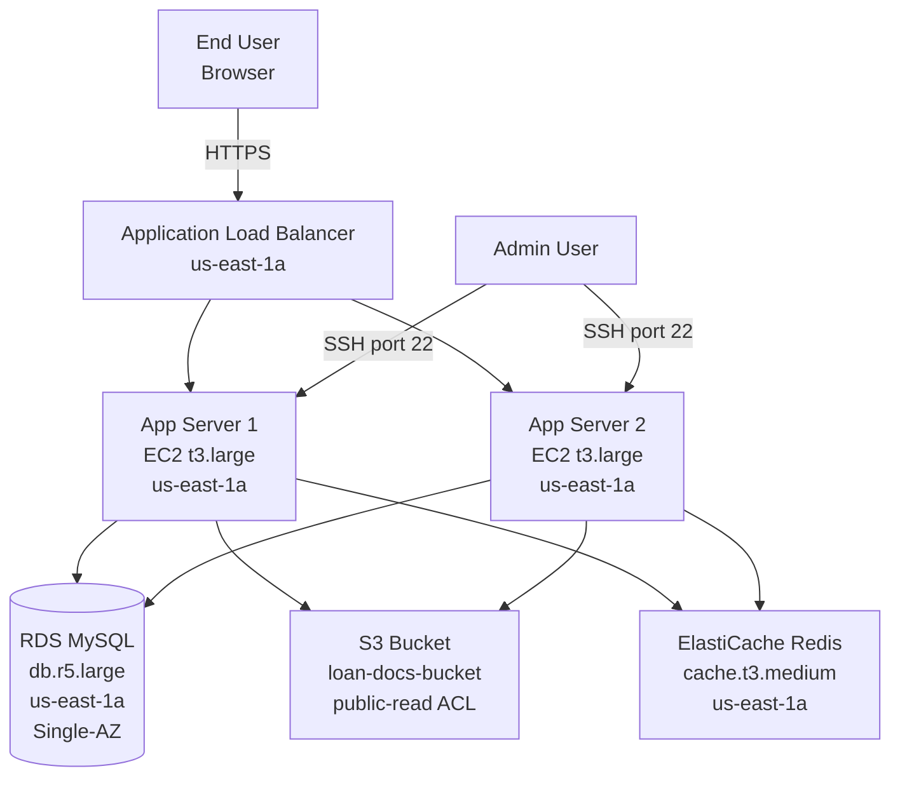

# Review Bank — Case 01: Three-Tier Web Application on AWS

> **คำแนะนำ:** เขียน review ของคุณเองก่อนดู answer key
> Answer key อยู่ที่ `../answer-keys/case-01-answer-key.md` — เปิดหลัง review เท่านั้น

---

## Submission Context

**App team:** Platform Team, Meridian Finance (fictional)
**Date submitted:** 2024-11-15
**Review type:** Pre-production design review
**Kata reference:** Level 2 — AZ-resilient three-tier application

---

## Team's Description

เราต้องการ deploy web application สำหรับ loan origination portal ของ Meridian Finance บน AWS
Application รับ application form จาก end user, process ด้วย business logic, และ store ข้อมูลใน database

คาด traffic 500-1,000 concurrent users ช่วง peak (business hours) application ต้อง available ตลอด business hours (09:00-18:00) และ accept submission ได้ตลอด 24 ชั่วโมง

---

## Architecture Diagram

---

## Team's Key Decisions

**เลือก ALB เพราะ:** รองรับ HTTPS termination และ path-based routing ได้ ราคาถูกกว่า NLB สำหรับ use case นี้

**เลือก RDS MySQL เพราะ:** team คุ้นเคย, managed service ไม่ต้อง maintain, backup อัตโนมัติ

**เลือก ElastiCache Redis เพราะ:** cache session data และ rate-limit counter ไม่ต้องไป query DB ทุก request

**เลือก S3 เพราะ:** เก็บ document ที่ user upload (KYC documents, income statement) ราคาถูก, durable

**เรื่อง deployment:** deploy manually ผ่าน SSH เข้า EC2 โดยตรง ยังไม่ได้ setup CI/CD เพราะ time constraint

**เรื่อง cost:** คาดว่าต่ำกว่า $500/month สำหรับ infra ทั้งหมด

---

## Team's Assumptions

- Traffic ส่วนใหญ่เป็น business hours Thailand time
- Document ที่ user upload ขนาดไม่เกิน 10 MB ต่อไฟล์
- ไม่มี compliance requirement พิเศษสำหรับ MVP phase นี้
- 2 app server เพียงพอสำหรับ load ปัจจุบัน

---

## Your Review Task

เขียน design review โดยตอบคำถามเหล่านี้:

1. Flaw ไหนบ้างที่จะทำให้ system พังหรือ expose security risk ใน production?
2. แต่ละ flaw — severity คืออะไร (Critical / High / Medium / Low) และ fix คืออะไร?
3. คำถามอะไรที่คุณจะถาม team ก่อนอนุมัติ design นี้?
4. มี acceptance criteria ไหนที่ควรเพิ่มก่อน go-live?

บันทึก review ของคุณไว้ก่อน แล้วค่อยดู answer key
