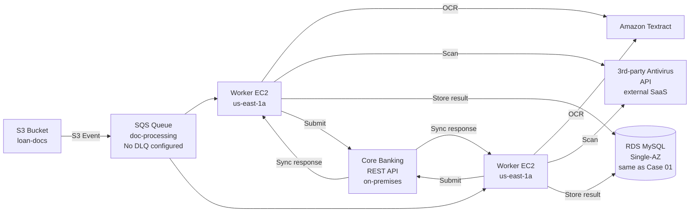

# Review Bank — Case 02: Async Document Processing Pipeline

> **คำแนะนำ:** เขียน review ของคุณเองก่อนดู answer key
> Answer key อยู่ที่ `../answer-keys/case-02-answer-key.md` — เปิดหลัง review เท่านั้น

---

## Submission Context

**App team:** Data Engineering Team, Meridian Finance (fictional)
**Date submitted:** 2024-12-03
**Review type:** Pre-production design review
**Kata reference:** Level 2 — async processing, queue patterns

---

## Team's Description

เราต้องการระบบ process document ที่ลูกค้า upload ผ่าน Loan Portal (Case 01) โดย:

1. รับ notification เมื่อ document upload เสร็จ
2. Validate file format และ scan virus
3. Extract text จาก PDF ด้วย OCR
4. ส่ง extracted data ไปยัง core banking system ผ่าน REST API
5. บันทึกผลลัพธ์ใน database

เวลาประมวลผลต่อ document คาดว่า 30-90 วินาที ปริมาณสูงสุด 500 document ต่อชั่วโมง

---

## Architecture Diagram

---

## Team's Key Decisions

**เลือก SQS เพราะ:** managed service ไม่ต้อง run message broker เอง, รองรับ at-least-once delivery

**เลือก EC2 worker เพราะ:** OCR งาน CPU intensive, Lambda timeout 15 นาทีอาจไม่พอ

**เลือก Textract เพราะ:** managed OCR, ไม่ต้อง maintain ML model

**เลือก synchronous call ไปยัง Core Banking เพราะ:** ต้องการ real-time confirmation ว่า data ถูก accept

**เรื่อง retry:** ถ้า worker fail ระหว่าง process SQS จะ re-deliver message หลัง visibility timeout

**เรื่อง monitoring:** ดู CloudWatch metrics สำหรับ queue depth และ EC2 CPU usage

---

## Team's Assumptions

- Core Banking API available 99% ของเวลา
- Antivirus SaaS respond ภายใน 5 วินาที
- Document ทุกชิ้นต้องผ่าน OCR และ antivirus ก่อน submit ไป Core Banking
- Worker 2 ตัวเพียงพอสำหรับ load ปัจจุบัน — scale ด้วยการ add worker เพิ่ม

---

## Your Review Task

เขียน design review โดยตอบคำถามเหล่านี้:

1. Flaw ไหนบ้างที่จะทำให้ system พังหรือ data loss ใน production?
2. แต่ละ flaw — severity คืออะไร (Critical / High / Medium / Low) และ fix คืออะไร?
3. คำถามอะไรที่คุณจะถาม team ก่อนอนุมัติ design นี้?
4. มี acceptance criteria ไหนที่ควรเพิ่มก่อน go-live?

บันทึก review ของคุณไว้ก่อน แล้วค่อยดู answer key
