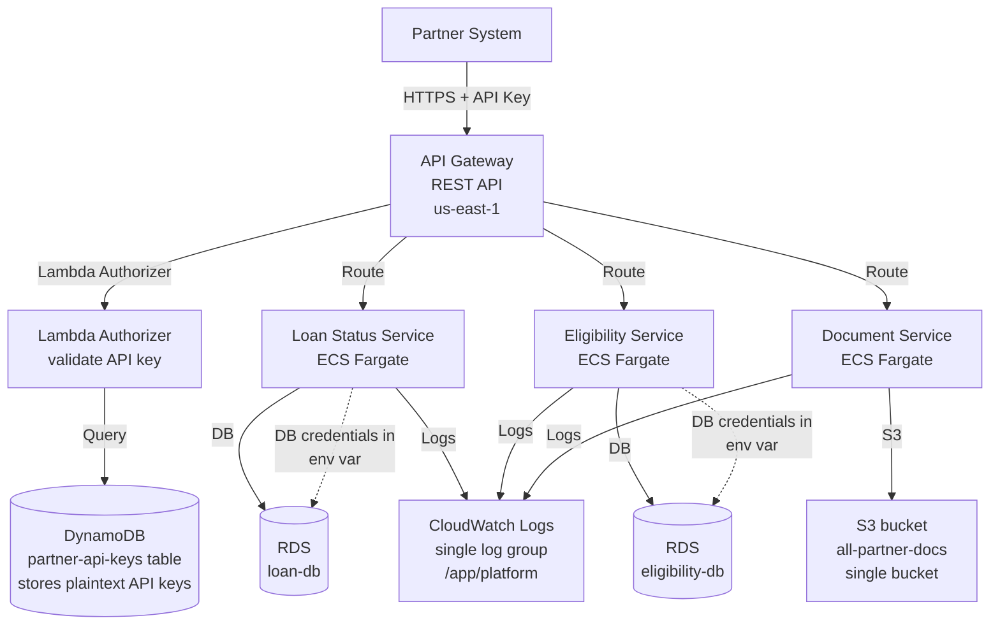

# Review Bank — Case 03: Multi-Tenant API Platform

> **คำแนะนำ:** เขียน review ของคุณเองก่อนดู answer key
> Answer key อยู่ที่ `../answer-keys/case-03-answer-key.md` — เปิดหลัง review เท่านั้น

---

## Submission Context

**App team:** API Platform Team, Meridian Finance (fictional)
**Date submitted:** 2025-01-10
**Review type:** Pre-production design review
**Kata reference:** Level 2-3 — multi-tenancy, secrets management, observability

---

## Team's Description

เราต้องการ platform กลางสำหรับ expose internal services ไปยัง partner บริษัทภายนอก (fintech partners, insurance companies) ผ่าน REST API

แต่ละ partner ได้รับ API key สำหรับ authenticate และถูก rate-limit ตามแผนที่ subscribe ไว้ Platform ต้องรองรับ 20 partners ในวันนี้ คาด 100 partners ใน 1 ปี

Service ที่ expose: Loan Status API, Customer Eligibility API, Document Submission API

---

## Architecture Diagram

---

## Team's Key Decisions

**เลือก API Gateway + Lambda Authorizer เพราะ:** managed, serverless, ไม่ต้อง manage infra สำหรับ auth logic

**เลือก DynamoDB เก็บ API key เพราะ:** query เร็ว, serverless, ราคาถูก

**เลือก single S3 bucket เพราะ:** ง่ายกว่า manage, ใช้ key prefix `{partner-id}/` แยก partner data

**เรื่อง DB credentials:** ใส่ใน environment variable ของ ECS task definition เพราะสะดวกและเร็ว, จะ migrate ไป Secrets Manager ทีหลัง

**เรื่อง logging:** ส่ง log ทุก service ไปที่ CloudWatch log group เดียวกันก่อน เพราะ setup ง่าย

**เรื่อง rate limiting:** ใช้ API Gateway built-in usage plan per API key

**เรื่อง monitoring:** ดู CloudWatch metrics: API Gateway 4xx/5xx rate, Lambda invocation count

---

## Team's Assumptions

- Partner ทุก partner เชื่อถือได้ — ทำ contract แล้ว ไม่ต้องการ extra isolation
- DB credentials ไม่ค่อยเปลี่ยน — rotate ปีละครั้งพอ
- Document ของ partner แต่ละเจ้าไม่ sensitive เท่ากัน — share bucket ได้
- Monitoring จะเพิ่มเติมได้ทีหลังหลัง go-live

---

## Your Review Task

เขียน design review โดยตอบคำถามเหล่านี้:

1. Flaw ไหนบ้างที่จะทำให้เกิด security incident หรือ compliance issue ใน production?
2. แต่ละ flaw — severity คืออะไร (Critical / High / Medium / Low) และ fix คืออะไร?
3. คำถามอะไรที่คุณจะถาม team ก่อนอนุมัติ design นี้?
4. มี acceptance criteria ไหนที่ควรเพิ่มก่อน go-live?

บันทึก review ของคุณไว้ก่อน แล้วค่อยดู answer key
