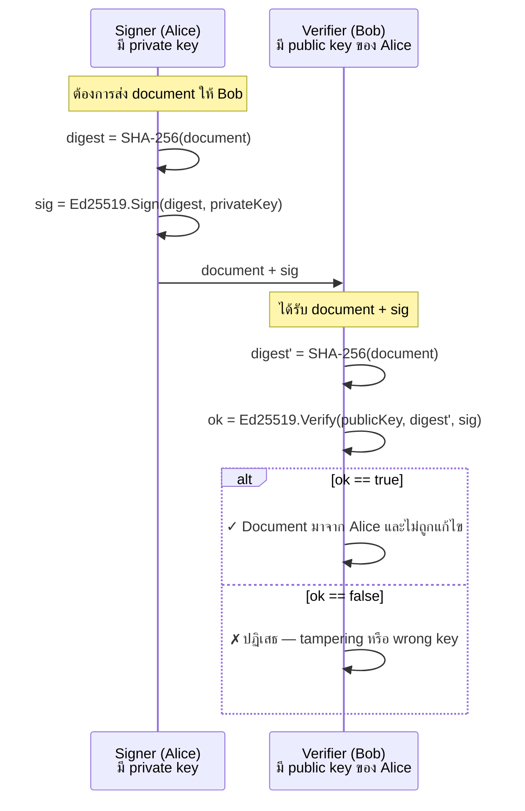

# Concept: Digital Signature

Digital signature คือกลไกที่พิสูจน์ทั้ง **origin** (ใครเซ็น) และ **integrity** (ข้อมูลไม่ถูกแก้ไข) โดยใช้ asymmetric key pair — สิ่งที่ hash อย่างเดียวทำไม่ได้

---

## สามปฏิบัติการ: Hash / Encrypt / Sign

| ปฏิบัติการ | Key ที่ใช้ | ใครถือ Key | จุดประสงค์ | กลับทิศได้? |
|---|---|---|---|---|
| **Hash** (SHA-256) | ไม่มี | — | ตรวจ integrity เท่านั้น | ไม่ได้ |
| **Symmetric encrypt** (AES) | Shared key | ทั้งสองฝ่าย | ปกปิดเนื้อหา | ได้ (same key) |
| **Asymmetric encrypt** (RSA/ECDH) | Public (encrypt) / Private (decrypt) | ผู้รับถือ private | ปกปิดเนื้อหา | ได้ (private key) |
| **Digital sign** (Ed25519/ECDSA) | **Private** (sign) / **Public** (verify) | **ผู้ส่งถือ private** | ยืนยันตัวตน + integrity | ไม่ได้ |

> **กฎจำง่าย:**
> - Encrypt: ใช้ public key ของ**ผู้รับ** (ใครก็ encrypt ได้; แค่ผู้รับถอดได้)
> - Sign: ใช้ private key ของ**ผู้ส่ง** (แค่ผู้ส่งเซ็นได้; ใครก็ verify ได้)

---

## ทำไมต้อง Sign **hash** ไม่ใช่ไฟล์ทั้งหมด

Ed25519 (และ RSA, ECDSA) ทำงานบน **byte array** ขนาดคงที่ หากต้องการ sign ไฟล์ 5 GB โดยตรง จะเกิดปัญหาสามอย่าง:

1. **ความเร็ว** — asymmetric operation ช้ากว่า hashing หลาย order of magnitude
2. **ขนาด signature** — ถ้า sign ทีละ block, signature จะโตตามขนาดไฟล์
3. **Safety (Ed25519)** — `ed25519.Sign()` ใน Go ต้องการ `[]byte` ทั้งหมดในหน่วยความจำ; ไม่รองรับ streaming

วิธีที่ถูกต้อง:

```
hash = SHA-256(file)       // streaming-friendly, O(1) memory
sig  = Ed25519.Sign(hash)  // sign เฉพาะ 32 bytes
```

ผลลัพธ์ signature มีขนาดคงที่ 64 bytes ไม่ว่าไฟล์จะใหญ่แค่ไหน

> **หมายเหตุ Go:** `ed25519.Sign(privateKey, message)` ต้องการ `message` ทั้งหมดใน `[]byte` — ไม่มี `io.Reader` variant
> ถ้าต้องการ sign stream ให้ hash ก่อน (`sha256.New()` + `io.Copy`) แล้ว sign เฉพาะ digest

---

## Sign/Verify Flow



---

## Key Pair — บทบาทของแต่ละ Key

```
private key  →  เก็บเป็นความลับ  →  ใช้ Sign
public key   →  แจกจ่ายได้เลย   →  ใช้ Verify
```

- **Private key** เปรียบเหมือนลายมือชื่อจริง — มีได้คนเดียว
- **Public key** เปรียบเหมือนตัวอย่างลายมือชื่อ — แจกให้ทุกคนที่ต้องการ verify

ถ้า private key รั่ว ทุก signature ที่เคยทำด้วย key นั้นต้องถือว่า untrustworthy (เพราะคนอื่นสร้าง signature ใหม่ได้)

---

## Certificate, X.509, CA, Self-Signed

**ปัญหา:** Bob มี public key ของ Alice แต่จะรู้ได้อย่างไรว่า "public key นี้คือ Alice จริงๆ"?

**Certificate** คือเอกสารที่บอกว่า "public key X เป็นของ entity Y" — และเอกสารนั้นถูก **sign โดยบุคคลที่สาม** ที่เชื่อถือได้

### X.509 Certificate (รูปแบบมาตรฐาน)

```
Subject:    CN=Alice, O=Hospital, C=TH
Public Key: Ed25519 / RSA / ECDSA key
Issuer:     CN=HospitalCA, O=Hospital
NotBefore:  2024-01-01
NotAfter:   2025-01-01
KeyUsage:   DigitalSignature
Signature:  <signed by HospitalCA's private key>
```

### Certificate Authority (CA)

```
Root CA (self-signed)
  └── Intermediate CA (signed by Root CA)
        └── Alice's cert (signed by Intermediate CA)
```

- **Self-signed cert**: Issuer == Subject — ไม่มีบุคคลที่สามรับรอง, ใช้ใน dev/internal เท่านั้น
- **Chain verification**: Verifier ต้องตรวจทุก cert ใน chain จนถึง Root CA ที่ตัวเองเชื่อถือ

> **Trust anchor problem**: เชื่อ Root CA ได้เพราะ OS/browser pre-install ไว้ — ไม่ใช่เพราะมี proof ทางคณิตศาสตร์

### KeyUsage (x509.KeyUsage)

| Constant | ความหมาย |
|---|---|
| `KeyUsageDigitalSignature` | ใช้เซ็นเอกสาร/ข้อมูล |
| `KeyUsageCertSign` | ใช้ออก certificate ลูก (CA เท่านั้น) |
| `KeyUsageKeyEncipherment` | ใช้ encrypt symmetric key (TLS) |
| `KeyUsageContentCommitment` | Non-repudiation |

---

## Sign-then-Encrypt

เมื่อต้องการทั้ง **confidentiality** และ **authenticity**:

```
ciphertext = Encrypt(pubKey_Bob, Sign(privKey_Alice, message) + message)
```

ทำไมต้อง Sign **ก่อน** Encrypt?

- ถ้า Encrypt ก่อน แล้ว Sign: Charlie อาจ strip signature แล้วใส่ signature ตัวเอง — Bob จะเห็นว่า "Charlie ส่ง ciphertext ที่ Alice สร้าง" แทนที่จะเป็น "Alice ส่งให้ Bob"
- Sign-then-Encrypt: Bob ถอด encrypt แล้วได้ proof ว่า Alice sign content นั้นจริง

---

## Detached vs Embedded Signature

| ประเภท | ลักษณะ | ตัวอย่าง |
|---|---|---|
| **Detached** | Signature อยู่ในไฟล์แยก (`.sig`, `.asc`) | `document.pdf` + `document.pdf.sig` |
| **Embedded** | Signature อยู่ในไฟล์เดียวกับเนื้อหา | PDF signature (บน byte range), JWT |

**Detached signature** — ข้อดี/ข้อเสีย:
- ✓ ไฟล์ต้นฉบับไม่ถูกแก้ไข
- ✓ Sign/verify ง่ายกว่า (no format parsing)
- ✗ ต้องเก็บ/ส่งไฟล์ .sig ควบคู่เสมอ; ถ้าหาย ก็ verify ไม่ได้

---

## Multi-Signer Chain

เมื่อต้องการลายเซ็นหลายคน (เช่น แพทย์ → หัวหน้า → ผู้อำนวยการ):

```
sig1 = Sign(privKey_Doctor,   hash(document))
sig2 = Sign(privKey_Head,     hash(document + sig1))
sig3 = Sign(privKey_Director, hash(document + sig1 + sig2))
```

**Property สำคัญ**: signer ลำดับหลังต้อง cover ทุก signature ก่อนหน้า

- ถ้าใครลบ `sig1` ออก → `sig2` verify ไม่ผ่าน (เพราะ hash ไม่ตรง)
- ถ้าใครสลับลำดับ `sig1` ↔ `sig2` → `sig3` verify ไม่ผ่าน
- ถ้าแต่ละคน sign เฉพาะ document (ไม่ cover sig ก่อนหน้า) → ลบ/สลับ sig ได้โดยไม่มีใครรู้

---

## PDF Signing — ภาพรวม

PDF signing มีความซับซ้อนเพิ่มเติมจาก generic signing:

### Incremental Update
PDF spec อนุญาตให้ **append** data ต่อท้ายไฟล์โดยไม่แก้ไข byte เดิม — signature จึงครอบคลุมเฉพาะ **byte range** ที่ระบุ ไม่ใช่ทั้งไฟล์

```
[original PDF bytes][signature field cover range][... new appended data ...]
                    ^-- ByteRange: [0, offset1, offset2, length]
```

### PAdES (PDF Advanced Electronic Signatures)
มาตรฐาน ETSI EN 319 102 กำหนดหลายระดับ:

| ระดับ | เพิ่มอะไร |
|---|---|
| PAdES-B-B | Signature พื้นฐาน |
| PAdES-B-T | + Trusted timestamp (signing time จาก TSA) |
| PAdES-B-LT | + เก็บ revocation info ไว้ใน PDF |
| PAdES-B-LTA | + Archive timestamp (LTV — Long-Term Validation) |

### Timestamp และ LTV
- **Timestamp**: หลักฐานว่า document ถูก sign **ก่อน** เวลาที่ระบุ — ออกโดย Time Stamping Authority (TSA)
- **LTV (Long-Term Validation)**: เก็บ certificate + revocation info ไว้ใน PDF ทำให้ verify ได้แม้ cert หมดอายุแล้ว

### HSM (Hardware Security Module)
- Private key ของ CA หรือ signing service อยู่ใน HSM — ไม่มีทางดึง private key ออกมาได้
- Signing operation เกิดใน HSM; software เห็นแค่ signature result

> **Scope note:** รายละเอียด byte-range encoding, CAdES embedded CMS structure, และ PAdES revision handling อยู่นอก scope ของเอกสารนี้

---

## ความสัมพันธ์กับ Concept อื่น

- **JWT** — ใช้ digital signature (RS256/ES256/EdDSA) เพื่อ sign payload; ดู [`jwt.md`](./jwt.md) โดยเฉพาะส่วน algorithm confusion
- **WebAuthn** — ใช้ asymmetric key pair ที่ถือโดย authenticator (passkey) เพื่อ sign challenge; ดู [`webauthn.md`](./webauthn.md) สำหรับ sign counter และ attestation

---

## Go Quick Reference

```go
import (
    "crypto/ed25519"
    "crypto/sha256"
    "crypto/x509"
    "encoding/pem"
    "io"
    "os"
)

// Generate key pair
pub, priv, _ := ed25519.GenerateKey(nil)

// Hash a large file (streaming, O(1) memory)
f, _ := os.Open("document.pdf")
h := sha256.New()
io.Copy(h, f)
digest := h.Sum(nil) // []byte, 32 bytes

// Sign (Ed25519 requires full []byte — sign the digest, not the file)
sig := ed25519.Sign(priv, digest) // 64 bytes

// Verify (returns bool, not error)
ok := ed25519.Verify(pub, digest, sig)

// Save private key (PKCS#8 PEM, type "PRIVATE KEY")
der, _ := x509.MarshalPKCS8PrivateKey(priv)
pem.Encode(os.Stdout, &pem.Block{Type: "PRIVATE KEY", Bytes: der})

// Load private key
block, _ := pem.Decode(pemBytes)
key, _   := x509.ParsePKCS8PrivateKey(block.Bytes)
edKey    := key.(ed25519.PrivateKey)
```
