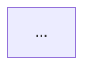

# [Kata title]

## Context

<!-- ทำไม problem นี้ถึงสำคัญใน real systems
     เขียน 2-4 ประโยค ตั้ง scene ก่อน ไม่ต้องอธิบาย solution -->

## Real World Incidents

<!-- ใส่เฉพาะ incident ที่มี public source link ที่ verified แล้ว
     ถ้ายังไม่ verify → label ว่า "Illustrative scenario" แทน
     ห้ามคัดลอกข้อความจาก source — สรุปด้วยคำของตัวเอง -->

- **[Service/Company], [Year]** — [สรุปเหตุการณ์ใน 1-2 ประโยค]
  Source: [URL]

## The Naive Design

<!-- วาด Mermaid diagram แสดง naive design
     อธิบายว่ามันพังตรงไหน และภายใต้เงื่อนไขอะไร
     ห้ามบอก solution ในส่วนนี้ -->

**ทำไม naive design นี้ถึงพัง:** ...

## Explore First

<!-- ชื่อ AWS docs / features ที่ต้องไปอ่านก่อนเริ่ม — ไม่ใช่คำตอบ
     เป้าหมาย: learner เปิด docs อ่านเอง แล้วค่อย design -->

- AWS doc: **[ชื่อ doc / guide]** — อ่านเพื่อเข้าใจ [concept ที่เกี่ยวข้อง]
- AWS feature: **[ชื่อ feature]** — ดูว่า default behavior คืออะไร
- Concept: **[ชื่อ concept]** — คำถามที่ต้องตอบได้ก่อน design: [คำถาม]

## Task

<!-- 1-3 ประโยค อธิบายว่าต้องทำอะไร
     เป็น scenario problem — ไม่ใช่ quiz -->

...

## Constraints

- ...
- ...

## What to Submit

1. **Architecture diagram** — วาดด้วย tool ที่ถนัด (draw.io, Excalidraw, Mermaid) แล้ว export เป็น PNG/SVG
2. **Key Decisions** — ใช้ template ใน `templates/key-decisions-template.md`
3. **Assumptions** — สิ่งที่ assume เกี่ยวกับ traffic, data, team, compliance

บันทึก submission ไว้ที่ `architecture/submissions/YYYY-MM-DD-<kata-name>/`

## Acceptance Criteria

- [ ] ...
- [ ] ...
- [ ] ...

## Concepts Involved

- [`concept-name`](../../concepts/concept-name.md) — ...
